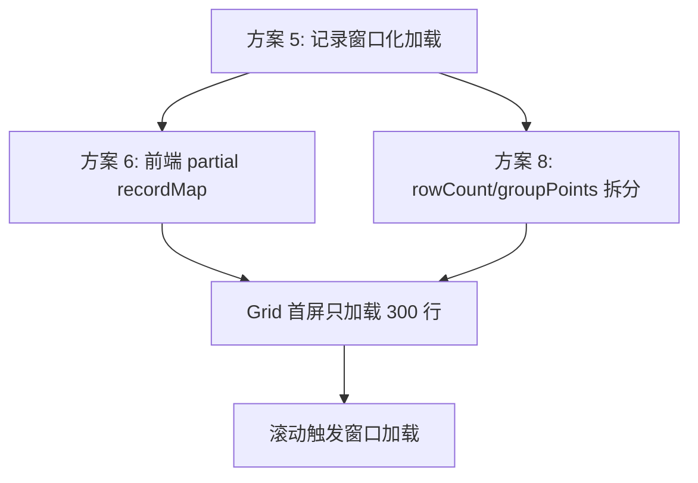

# 大表首次打开性能 — 技术方案评估报告

> 本报告基于对 APITable/vika fork 项目源码的深入调研，结合自部署场景的实际情况，对 [技术方案清单](file:///d:/CodeAI/vika/docs/self-host-large-datasheet-technical-options.md) 中列出的 22+ 个技术方案逐一进行评估。报告最后给出推荐的完整技术修改路线。

---

## 项目现状速查

在评估之前，先整理从源码调研中获得的关键现状事实：

| 关键维度 | 现状 |
|---------|------|
| React 版本 | **18.2.0**（已具备并发渲染 API，但尚未在核心加载路径中深度使用） |
| Next.js 版本 | **12.3.4**（有 `getServerSideProps`，无 App Router） |
| Konva 网格 | **已按可视行列虚拟化绘制**，渲染本身不是瓶颈 |
| dataPack 加载 | `fetchDatasheetPack` **首次打开路径默认加载全量 recordMap**；项目已有 partial data 基础设施，但未作为大表首开主链路使用 |
| 关联表扩展 | `datasheetFieldHandler.analyze` 扫描所有 link/lookup/formula 字段，**每个关联表全量读取记录** |
| 视图派生 | 在 `DATAPACK_LOADED` 后 **同步在主线程** 执行全量 filter/sort/group/search |
| Worker | 基础设施 **存在但已禁用**，有 `StoreWorker`、`compute.ts` 等文件 |
| partial data | `isPartOfData` 标志 **存在但硬编码为 false**，`SET_RECORDS` reducer 可合并记录 |
| `loadRecords` 工具 | **已存在**，可按 recordIds 补加载，但仅用于补充加载 |
| `fetchRecords` API | 服务端 **已有** 按 recordIds 查询记录能力 |
| `fetchMeta` API | 服务端 **已有** 只返回 meta 不含记录的接口 |
| SSR | `getServerSideProps` **存在但不预取数据**，仅做认证和路由 |
| Redis 缓存 | 用于协同/房间管理，**dataPack 和视图计算结果完全无缓存** |
| 网关压缩 | gzip **已配置**，brotli **未配置** |
| databus/wasm | 基础设施 **存在但未启用**，`getBrowserDatabusApiEnabled()` 返回 `false` |
| 数据库 | `datasheet_record` 表，记录值存为 JSON `data` 列 |

### 时间分布估算（大表首开）

```
服务端全量查询 + 关联扩展  ████████████████████  ~40-60%
网络传输大 JSON           ████████              ~10-15%
浏览器 JSON 解析          █████                 ~5-10%
Redux 写入               ████                  ~5-10%
视图派生（filter/sort等）  ████████████          ~15-25%
Konva 渲染               ██                    ~3-5%
```

---

## 方案逐一评估

### 方案 1：基线测量和链路埋点

| 维度 | 评估 |
|------|------|
| **可行性** | ⭐⭐⭐⭐⭐ 极高 |
| **收益** | 间接但关键 — 为后续所有优化提供数据依据 |
| **复杂度** | 低（日志 + performance.mark + 简单面板） |
| **风险** | 几乎无 |

> [!TIP]
> **强烈推荐作为第一步。** 不做埋点就做优化是盲人摸象。项目中已有 `performance.mark` 的零星使用，但缺乏系统化的链路覆盖。建议在 [datasheet.service.ts](file:///d:/CodeAI/vika/packages/room-server/src/database/datasheet/services/datasheet.service.ts)、[view_derivation_middleware.ts](file:///d:/CodeAI/vika/packages/datasheet/src/pc/store/view_derivation_middleware.ts)、[datasheet.ts (actions)](file:///d:/CodeAI/vika/packages/core/src/modules/database/store/actions/resource/datasheet/datasheet.ts) 等关键节点添加结构化计时。

**评估结论**：✅ **必做，最高优先级，零风险高回报。**

---

### 方案 2：自部署 fast dataPack

| 维度 | 评估 |
|------|------|
| **可行性** | ⭐⭐⭐⭐⭐ 极高 |
| **收益** | 中到高 — 直接减少首包数据量 |
| **复杂度** | 低到中 |
| **风险** | 低（配置开关可回退） |

**源码发现**：
- [datasheet.service.ts](file:///d:/CodeAI/vika/packages/room-server/src/database/datasheet/services/datasheet.service.ts) 的 `fetchCommonDataPack` 构造完整 dataPack 时包含 `recordMeta`（含 `revisionHistory`）、`commentCount`、完整 `foreignDatasheetMap`
- `commentCount` 已有独立的 `fetchCommentCount` API，说明拆分是可行的
- `foreignDatasheetMap` 的全量扩展是最大的不必要开销 — 一个有 5 个 link 字段指向 5 张万行表的数据表，会额外加载 5 万条记录

**可执行的快赢项**：
1. 延迟 `commentCount` — 评论面板打开时再加载（已有 API）
2. 延迟 `revisionHistory` — 历史面板打开时再加载
3. 限制 `foreignDatasheetMap` 初始加载量 — 只加载关联表 meta + 首屏可见的关联记录

**评估结论**：✅ **强烈推荐，性价比极高，可快速实施。**

---

### 方案 3：网关压缩和传输优化

| 维度 | 评估 |
|------|------|
| **可行性** | ⭐⭐⭐⭐⭐ 极高 |
| **收益** | 低到中 — gzip 已启用，增加 brotli 收益有限 |
| **复杂度** | 低 |
| **风险** | 几乎无 |

**源码发现**：
- [server.js](file:///d:/CodeAI/vika/packages/datasheet/server.js) 使用 Express `compression` 中间件
- 网关 nginx 已配置 gzip
- brotli 未配置，增加后对大 JSON 可再压缩 15-20%

**但有上限**：压缩只减少传输时间，不减少浏览器解析和计算时间。如果首包仍是 10MB 的全量 JSON，压缩到 1.5MB（gzip）或 1.2MB（brotli），差异不大。

**评估结论**：✅ **推荐作为基础工作，但不应作为主要优化手段。**

---

### 方案 4：服务端视图索引缓存

| 维度 | 评估 |
|------|------|
| **可行性** | ⭐⭐⭐ 中等 |
| **收益** | 高 — 重复打开同一视图可跳过计算 |
| **复杂度** | 高到很高 |
| **风险** | 中高 — 缓存一致性、权限维度、跨表依赖 |

**源码发现**：
- 当前 Redis **完全没有用于 dataPack 或视图结果缓存**
- 视图派生计算依赖 `getCellValue`，对 formula/lookup 字段会递归跨表取值
- 字段权限 (`fieldPermissionMap`) 会影响可见字段，进而影响排序/分组结果
- 缓存 key 需要包含 `revision`、`permissionScope`、`queryHash` 等维度

**主要障碍**：
- 服务端要复用 `@apitable/core` 的 view derivation 逻辑才能保证语义一致
- 公式/lookup 的跨表依赖需要依赖图或保守失效
- 实现完整版需要 40-80 个文件的改动

**评估结论**：⚠️ **收益高但实施成本极高，建议在窗口化加载完成后作为第二阶段缓存优化。**

---

### 方案 5：记录窗口化加载

| 维度 | 评估 |
|------|------|
| **可行性** | ⭐⭐⭐⭐ 高（因为已有基础设施） |
| **收益** | ⭐⭐⭐⭐⭐ 极高 — 从根本上解决大表首包问题 |
| **复杂度** | 高（但项目有可复用基础） |
| **风险** | 中 — 需要适配 partial data |

**源码发现 — 已有基础设施**：
- ✅ [datasheet.record.service.ts](file:///d:/CodeAI/vika/packages/room-server/src/database/datasheet/services/datasheet.record.service.ts) 已有 `getRecordsByDstIdAndRecordIds` 按 ID 查询记录
- ✅ [datasheet.record.service.ts](file:///d:/CodeAI/vika/packages/room-server/src/database/datasheet/services/datasheet.record.service.ts) 已有 `getRecordIdsByDstId` 只返回 ID 列表
- ✅ [load_records.ts](file:///d:/CodeAI/vika/packages/datasheet/src/pc/utils/load_records.ts) 已有 `loadRecords` 按 recordIds 补加载
- ✅ [datasheet_api.ts](file:///d:/CodeAI/vika/packages/core/src/modules/database/api/datasheet_api.ts) 已有 `fetchRecords` API
- ✅ Redux reducer 已有 `SET_RECORDS` action 可合并记录到已有 recordMap
- ✅ `isPartOfData` 标志已存在于 state shape

**需要新增**：
- 按 view + offset/limit 返回 rowIds window 的 API
- 前端滚动到 recordIds window 的映射
- 缺失记录的 loading 状态和 UI

**关键约束**：即使无过滤/排序/分组，也需确保行顺序符合当前视图语义（而非纯数据库物理顺序）。简单视图可先从现有 snapshot/view row 顺序或 record id 顺序索引中切窗口；复杂视图再引入服务端 viewIndex 派生和缓存。

**评估结论**：✅ **核心方案，建议作为主要技术路线的中心。现有基础设施让实施成本大幅低于从零开始。**

---

### 方案 6：前端 partial recordMap

| 维度 | 评估 |
|------|------|
| **可行性** | ⭐⭐⭐⭐ 高 |
| **收益** | ⭐⭐⭐⭐⭐ 极高（方案 5 的必要配套） |
| **复杂度** | 高 |
| **风险** | 中 — 需要审查大量 selector |

**源码发现**：
- `isPartOfData` 标志已存在但硬编码为 `false`
- `SET_RECORDS` reducer 已能合并记录
- [cell_calc.ts](file:///d:/CodeAI/vika/packages/core/src/modules/database/store/selectors/resource/datasheet/cell_calc.ts) 的 `getCellValue` 假设 `recordMap[recordId]` 始终存在
- [rows_calc.ts](file:///d:/CodeAI/vika/packages/core/src/modules/database/store/selectors/resource/datasheet/rows_calc.ts) 的所有 selector 假设完整 recordMap
- Konva 单元格渲染假设 record 数据已加载

**影响范围审查**：
- 复制粘贴、填充柄、整列统计需要适配
- 导出功能可能需要先完成全量加载或走服务端
- widget-sdk 需要适配
- 仪表盘、API 面板可能依赖完整数据

**评估结论**：✅ **方案 5 的必要配套，应一起规划实施。可以先覆盖 Grid view 的核心渲染路径，其他场景逐步适配。**

---

### 方案 7：服务端过滤/排序/分组/搜索下推

| 维度 | 评估 |
|------|------|
| **可行性** | ⭐⭐ 低到中 |
| **收益** | 高（但需要大量基础工作） |
| **复杂度** | 高到很高 |
| **风险** | 高 — 前后端语义一致性 |

**源码发现**：
- 当前所有 filter/sort/group/search 逻辑在 [view_derivate_base.ts](file:///d:/CodeAI/vika/packages/core/src/compute_manager/view_derivate/view_derivate_base.ts) 和 `slice/` 目录中用 TypeScript 实现
- `getCellValue` 对 formula/lookup 有递归依赖
- 单选字段排序按选项定义顺序而非字母序
- 将这些语义翻译为 SQL 极其困难

**可行的折中**：
- 服务端复用 `@apitable/core` 的 view derivation（Node.js 运行），不翻译为 SQL
- 只缓存 rowIds 结果，不缓存完整 recordMap
- 这实际上就是方案 4（服务端视图索引缓存）的实现路径之一

**评估结论**：⚠️ **完整 SQL 下推不推荐。建议走"服务端复用 core 计算 + 缓存 rowIds"的路径，作为方案 4 的实现策略。**

---

### 方案 8：rowCount/groupPoints/aggregation 拆分接口

| 维度 | 评估 |
|------|------|
| **可行性** | ⭐⭐⭐⭐ 高 |
| **收益** | 中 — 解耦统计和首屏渲染 |
| **复杂度** | 中到高 |
| **风险** | 低 |

**源码发现**：
- 当前 `dataPack` 不包含独立的 `rowCount` 或 `groupPoints`，这些在前端视图派生中计算
- [datasheet.controller.ts](file:///d:/CodeAI/vika/packages/room-server/src/database/datasheet/controllers/datasheet.controller.ts) 目前没有独立的统计/分组端点
- 如果先实现记录窗口化加载（方案 5），这些接口就是必需的配套

**评估结论**：✅ **方案 5 的必要配套，应一起规划。** Grid 首屏需要 `rowCount` 建立滚动高度。

---

### 方案 9：视图派生 Worker 化

| 维度 | 评估 |
|------|------|
| **可行性** | ⭐⭐⭐⭐ 高（Worker 基础设施已存在） |
| **收益** | 中 — 减少主线程卡顿，不减少数据量 |
| **复杂度** | 中 |
| **风险** | 中 — snapshot 传输成本 |

**源码发现**：
- [worker/index.ts](file:///d:/CodeAI/vika/packages/datasheet/src/pc/worker/index.ts)、[store_worker.ts](file:///d:/CodeAI/vika/packages/datasheet/src/pc/worker/store/store_worker.ts)、[compute.ts](file:///d:/CodeAI/vika/packages/datasheet/src/pc/worker/store/compute.ts) **已有完整的 Worker 基础设施**
- `StoreWorker` 类已能维护独立 Redux store、接收 action、执行视图派生
- 但当前 **被禁用**

**关键限制**：
- 如果首包仍是全量 recordMap，序列化传入 Worker 的成本也很高（structuredClone 或 JSON）
- Worker 化的最大价值在于：首包减少到窗口级别后，Worker 处理增量视图更新时不阻塞 UI

**评估结论**：✅ **推荐在窗口化加载完成后启用。单独做收益有限，但与窗口化配合效果好。**

---

### 方案 10：主线程计算切片

| 维度 | 评估 |
|------|------|
| **可行性** | ⭐⭐⭐ 中等 |
| **收益** | 低到中 — 改善交互响应，不减少总计算量 |
| **复杂度** | 中 |
| **风险** | 中 — 中间状态处理复杂 |

**源码发现**：
- [view_derivation_middleware.ts](file:///d:/CodeAI/vika/packages/datasheet/src/pc/store/view_derivation_middleware.ts) 当前是同步一次性计算
- 拆分为切片需要定义每个阶段的中间状态和 UI 表现
- 排序未完成时的编辑、选择、复制行为需要明确规则

**与其他方案的关系**：
- 如果实施了窗口化加载（方案 5），首屏视图派生的数据量已大幅减少，切片的必要性降低
- 如果启用了 Worker（方案 9），切片也不再需要

**评估结论**：⚠️ **可以跳过。Worker 化或窗口化加载都能更好地解决这个问题。**

---

### 方案 11：关联字段懒加载

| 维度 | 评估 |
|------|------|
| **可行性** | ⭐⭐⭐⭐ 高 |
| **收益** | ⭐⭐⭐⭐ 高 — 直接减少首包最大膨胀源 |
| **复杂度** | 高 — lookup/formula 及过滤/排序依赖复杂 |
| **风险** | 中高 — lookup/formula 依赖与视图语义一致性 |

**源码发现**：
- [datasheet.field.handler.ts](file:///d:/CodeAI/vika/packages/room-server/src/database/datasheet/services/datasheet.field.handler.ts) 的 `analyze` 方法扫描所有字段并构建外表依赖图
- 一个有 5 个 link 字段的表会触发 **5 个外表全量加载**，这是首包膨胀的最大来源之一
- [cell_calc.ts](file:///d:/CodeAI/vika/packages/core/src/modules/database/store/selectors/resource/datasheet/cell_calc.ts) 的 lookup/formula 计算需要外表 snapshot

**可行的分层与拆分策略**：
1. **第一层（非关键展示型数据延迟加载）**：首包仅加载关联表 meta（字段定义、视图配置），不加载其记录。link 单元格在未展开时，仅按需补加载或从当前关联信息中解析可见标题。
2. **第二层（计算语义型关联数据处理）**：lookup/formula 或当前视图 filter/sort/group 依赖关联表字段时，不可直接首屏占位（会改变排序筛选结果）。需在服务端进行依赖解析或在前端等待依赖数据补齐后再进行二次计算。

**评估结论**：✅ **强烈推荐，但复杂度偏高，不应简单作为“低复杂度”快赢。** 建议拆分为“延迟纯展示数据”与“处理计算语义关联”两步实施。

---

### 方案 12：公式和 lookup 预计算

| 维度 | 评估 |
|------|------|
| **可行性** | ⭐⭐ 低 |
| **收益** | 高（理论上） |
| **复杂度** | 高到很高 |
| **风险** | 高 — 依赖图、一致性、跨表更新 |

**源码发现**：
- `getCellValue` 对 formula/lookup 有递归依赖链
- 没有现有的依赖图基础设施
- 没有后台任务调度框架（虽然有 RabbitMQ）
- 需要处理字段类型变更、批量导入、循环依赖

**评估结论**：❌ **不推荐在当前阶段实施。复杂度极高，收益可以通过关联懒加载（方案 11）部分替代。**

---

### 方案 13：实时协同订阅范围收窄

| 维度 | 评估 |
|------|------|
| **可行性** | ⭐⭐ 低到中 |
| **收益** | 中 — 减少首屏后的资源消耗 |
| **复杂度** | 高到很高 |
| **风险** | 高 — OT/JOT、协同光标、编辑冲突 |

**源码发现**：
- 当前 JOT/OT 协同假设完整资源订阅
- 收窄订阅范围意味着可能丢失范围外的变更通知
- 编辑冲突解决和协同光标都依赖完整状态

**评估结论**：⚠️ **不推荐在早期阶段实施。可以用更简单的方式缓解 — 例如延迟建立实时连接到首屏渲染完成后。**

---

### 方案 14：客户端 IndexedDB 缓存

| 维度 | 评估 |
|------|------|
| **可行性** | ⭐⭐⭐ 中等 |
| **收益** | 中 — 仅重复打开有收益 |
| **复杂度** | 中到高 |
| **风险** | 中 — revision 校验、权限变化、存储限制 |

**关键限制**：**首次打开完全无收益。** 而用户反馈的问题主要是首次打开慢。

**评估结论**：⚠️ **可以作为后期锦上添花，但不应作为核心优化手段。**

---

### 方案 15：服务端 Redis/内存缓存和预热

| 维度 | 评估 |
|------|------|
| **可行性** | ⭐⭐⭐⭐ 高 |
| **收益** | 中到高 — 减少服务端重复计算 |
| **复杂度** | 中到高 |
| **风险** | 中 — 缓存一致性 |

**源码发现**：
- 当前 **完全没有** dataPack 或查询结果的 Redis 缓存
- 每次打开表都从数据库全量查询
- 自部署场景可以接受更多内存开销

**可选与推荐策略**：
- **推荐缓存**：优先缓存元数据 `meta`、`fieldPermissionMap` 及视图/窗口计算结果（key: `dstId:viewId:revision:queryHash`）。
- **谨慎/可选缓存**：直接缓存全量 `recordMap` 在自部署下虽可行，但可能引发内存消耗过大、权限控制失效、评论数 (`commentCount`)、`recordMeta` 和版本更新 (`revision`) 失效等一致性问题。

**评估结论**：✅ **推荐，优先缓存 meta 和 view/window 结果，谨慎缓存全量 recordMap。**

---

### 方案 16：SSR/服务端预取首屏窗口

| 维度 | 评估 |
|------|------|
| **可行性** | ⭐⭐⭐ 中等 |
| **收益** | 中 — 减少一个请求往返 |
| **复杂度** | 中 |
| **风险** | 中 — 登录态、权限、路由解析 |

**源码发现**：
- [workbench/[[...all]].tsx](file:///d:/CodeAI/vika/packages/datasheet/pages/workbench/%5B%5B...all%5D%5D.tsx) 已有 `getServerSideProps` 但 **不预取任何数据**
- 基础设施已存在，只需在 SSR 阶段调用 room-server 获取首屏数据

**关键约束**：
- SSR 预取需要正确传递 cookie/token
- 要限制首屏数据量，否则 HTML 体积暴增
- 如果已经实施了窗口化加载，SSR 预取的边际收益降低（只省了一个网络往返）

**评估结论**：⚠️ **可选的优化，但优先级低于窗口化加载本身。**

---

### 方案 17：React 18 并发渲染

| 维度 | 评估 |
|------|------|
| **可行性** | ⭐⭐⭐⭐ 高 |
| **收益** | 低到中 — 改善大表交互及切换卡顿 |
| **复杂度** | 低到中（无需升级，只需重构使用 API） |
| **风险** | 低（已有 React 18 环境，主要是调用风险） |

**源码发现**：
- 实际 `packages/datasheet/package.json` 中 `react` 和 `react-dom` 已经是 **18.2.0**，项目已具备 React 18 的并发特性和相关 API。
- 目前尚未在核心大表加载和渲染路径中深度使用并发特性。

**优化路径**：
- 评估是否在**大表加载状态切换**、**搜索输入过滤**、**视图类型切换**等重度 CPU 渲染场景下引入 `startTransition` 或 `useDeferredValue`。

**评估结论**：⚠️ **当前已具备 React 18 API。可作为后续改善交互响应的备选方案，开发成本较低，风险主要在于过渡态的 UI 表现。**

---

### 方案 18：替换或重构网格渲染层

| 维度 | 评估 |
|------|------|
| **可行性** | ⭐ 极低 |
| **收益** | 低 — Konva 网格已虚拟化，不是瓶颈 |
| **复杂度** | 很高 |
| **风险** | 极高 — 影响所有交互细节 |

**源码发现**：
- 当前 Konva 网格 **已经按可视行列虚拟化绘制**
- 选区、复制粘贴、填充柄、冻结列、拖拽、协同光标等交互都深度耦合 Konva
- 替换渲染层不解决首包和视图派生问题

**评估结论**：❌ **不推荐。投入产出比极低。当前 Konva 渲染不是瓶颈。**

---

### 方案 19：databus/wasm 路径评估

| 维度 | 评估 |
|------|------|
| **可行性** | ⭐⭐ 低 |
| **收益** | 不确定 |
| **复杂度** | 高 |
| **风险** | 高 — 语义一致性、权限、协同 |

**源码发现**：
- `getBrowserDatabusApiEnabled()` 返回 `false`
- databus-wasm-web、databus-client 包存在但 **从未在主数据加载路径中使用**
- 权限、关联字段、协同 revision 语义未经验证

**评估结论**：❌ **当前阶段不推荐。databus 的成熟度不足以支撑生产使用，验证成本高。**

---

### 方案 20：Arrow/二进制/列式传输

| 维度 | 评估 |
|------|------|
| **可行性** | ⭐ 极低 |
| **收益** | 中到高（理论上） |
| **复杂度** | 很高 |
| **风险** | 极高 — 影响整个数据模型 |

**评估结论**：❌ **不推荐。改变前后端数据协议的成本极高，且需要先完成窗口化加载才有意义。**

---

### 方案 21：DuckDB-Wasm/浏览器端分析

| 维度 | 评估 |
|------|------|
| **可行性** | ⭐ 极低 |
| **收益** | 低（对首次打开无帮助） |
| **复杂度** | 很高 |
| **风险** | 高 |

**评估结论**：❌ **不推荐。对首次打开速度无帮助，更适合报表/分析场景。**

---

### 方案 22：数据库索引/物化视图

| 维度 | 评估 |
|------|------|
| **可行性** | ⭐⭐⭐ 中等 |
| **收益** | 中 — 加速服务端查询 |
| **复杂度** | 中到很高 |
| **风险** | 中 |

**源码发现**：
- `datasheet_record` 表的记录值存为 JSON `data` 列，无法对具体字段值建索引
- 可以为 `dst_id + is_deleted` 建复合索引加速全表扫描
- 物化视图对 JSON 列数据的意义有限

**评估结论**：⚠️ **基础索引检查和优化值得做，但物化视图对当前数据模型帮助有限。**

---

### 方案 23-26 补充评估

| 方案 | 评估 | 结论 |
|------|------|------|
| **23. 搜索索引** | 中等可行性，中收益 | ⚠️ 可选，搜索频率低于首屏加载 |
| **24. 大批量操作服务端化** | 中等可行性，中收益 | ⚠️ 在 partial data 实施后有意义 |
| **25. 自部署服务端负载换速度** | 高可行性，是策略框架 | ✅ 作为整体策略指导，不是单独方案 |
| **26. Teable 类架构对照** | 参考价值高 | ✅ 作为目标架构参考 |

---

## 方案评估总览

| 方案 | 可行性 | 收益 | 复杂度 | 推荐 |
|------|--------|------|--------|------|
| 1. 基线测量和链路埋点 | ⭐⭐⭐⭐⭐ | 间接关键 | 低 | ✅ **必做** |
| 2. 自部署 fast dataPack | ⭐⭐⭐⭐⭐ | 中到高 | 低到中 | ✅ **强烈推荐** |
| 3. 网关压缩优化 | ⭐⭐⭐⭐⭐ | 低到中 | 低 | ✅ 基础工作 |
| 4. 服务端视图索引缓存 | ⭐⭐⭐ | 高 | 高到很高 | ⚠️ 第二阶段 |
| 5. 记录窗口化加载 | ⭐⭐⭐⭐ | 极高 | 高 | ✅ **核心方案** |
| 6. 前端 partial recordMap | ⭐⭐⭐⭐ | 极高 | 高 | ✅ **核心配套** |
| 7. 服务端过滤/排序下推 | ⭐⭐ | 高 | 高到很高 | ⚠️ 不推荐完整 SQL |
| 8. rowCount/groupPoints 拆分 | ⭐⭐⭐⭐ | 中 | 中到高 | ✅ 核心配套 |
| 9. 视图派生 Worker 化 | ⭐⭐⭐⭐ | 中 | 中 | ✅ 第二阶段 |
| 10. 主线程计算切片 | ⭐⭐⭐ | 低到中 | 中 | ⚠️ 可跳过 |
| 11. 关联字段懒加载 | ⭐⭐⭐⭐ | 高 | 中到高 | ✅ **强烈推荐** |
| 12. 公式/lookup 预计算 | ⭐⭐ | 高（理论） | 高到很高 | ❌ 不推荐 |
| 13. 协同订阅范围收窄 | ⭐⭐ | 中 | 高到很高 | ⚠️ 不推荐早期 |
| 14. IndexedDB 缓存 | ⭐⭐⭐ | 中 | 中到高 | ⚠️ 锦上添花 |
| 15. 服务端 Redis 缓存 | ⭐⭐⭐⭐ | 中到高 | 中到高 | ✅ 推荐 |
| 16. SSR 预取首屏 | ⭐⭐⭐ | 中 | 中 | ⚠️ 可选 |
| 17. React 18 并发渲染 | ⭐⭐⭐⭐ | 低到中 | 低到中 | ⚠️ 可选（已是 18，可按需使用 API） |
| 18. 替换网格渲染层 | ⭐ | 低 | 很高 | ❌ 不推荐 |
| 19. databus/wasm 路径 | ⭐⭐ | 不确定 | 高 | ❌ 不推荐 |
| 20. Arrow/二进制传输 | ⭐ | 中到高 | 很高 | ❌ 不推荐 |
| 21. DuckDB-Wasm | ⭐ | 低 | 很高 | ❌ 不推荐 |
| 22. 数据库索引 | ⭐⭐⭐ | 中 | 中到很高 | ⚠️ 基础检查 |

---

## 推荐的完整技术修改路线

基于以上评估，推荐分 **4 个阶段** 实施，每个阶段可独立交付收益。

### 阶段 0：观测基础（1-2 周）

> **目标**：建立性能基线，量化瓶颈分布


**实施内容**：
- [ ] **方案 1**：在 `fetchCommonDataPack`、`receiveDataPack`、`view_derivation_middleware`、Konva 首帧渲染等关键节点添加结构化计时
- [ ] **方案 3**：验证 gzip 配置，考虑增加 brotli，记录压缩前后响应大小
- [ ] **方案 22（部分）**：检查 `datasheet_record` 表的现有索引，确认 `dst_id + is_deleted` 复合索引存在

**预期产出**：基线数据报告，明确各环节耗时占比。

**预计改动规模**：~10 个文件，100-300 行

---

### 阶段 1：快速减载（2-4 周）

> **目标**：在不改变核心数据契约的前提下，减少首包数据传输（目标 30-60% 降幅，待基线验证）


**实施内容**：

- [ ] **方案 2 — fast dataPack**
  - 添加 `SELF_HOST_DEFER_COMMENT_COUNT=true` 配置开关
  - 首包不包含 `commentCount`，评论面板打开时调用已有 API
  - 首包不包含 `revisionHistory`，历史面板打开时加载
  - 裁剪 `recordMeta` 中非必要字段

- [ ] **方案 11 — 关联字段懒加载（拆分实施）**
  - **第一层**：优先延迟纯展示型的非关键关联表记录。首包只返回关联表 **meta**，不返回 records。link 单元格在未展开时按需/增量加载。
  - **第二层**：对有 filter/sort/group 依赖或 formula/lookup 依赖的字段进行依赖前置处理，不可简单以 loading/placeholder 占位而导致计算语义错误。
  - 添加 `SELF_HOST_DEFER_FOREIGN_RECORDS=true` 配置开关。

- [ ] **方案 15（部分）— 基础 Redis 缓存**
  - 优先缓存 meta + fieldPermissionMap（key: `dstId:revision`）以及 `units`/`userMap`。
  - 暂不推荐缓存全量 `recordMap` 以免带来内存与一致性问题。
  - revision 变化时进行失效处理。

**目标假设收益（待基线验证）**：
- 有 5 个 link 字段指向大表的数据表，首包预计可减少 70-80%
- 无 link 字段的表，首包预计可减少 10-20%
- 重复打开同一 revision 的表，meta 查询跳过

**预计改动规模**：~15-25 个文件，600-1500 行

---

### 阶段 2：窗口化加载核心（4-8 周）

> **目标**：实现记录窗口化加载，首屏只加载可视区域 + 缓冲区的记录



**实施内容**：

- [ ] **方案 5 — 服务端窗口化接口**
  - 新增 `GET /datasheets/:dstId/viewIndex?viewId=xxx&offset=0&limit=300` 接口
    - 简单视图（无筛选/排序/分组）：从现有 snapshot/view row 或 id 顺序切窗口，保证符合视图当前排序/行顺序语义，避免简单的物理顺序。
    - 复杂视图：服务端复用 `@apitable/core` 计算 rowIds 并缓存（方案 4 的简化版）。
  - 新增 `GET /datasheets/:dstId/recordsWindow?recordIds=xxx` 接口
    - 复用已有 `getRecordsByDstIdAndRecordIds`
  - 返回 `ViewIndexWindow { revision, rowCount, offset, limit, rowIds }`

- [ ] **方案 8 — 拆分接口**
  - 新增 `GET /datasheets/:dstId/views/:viewId/rowCount` 接口
  - `groupPoints` 可在首屏后异步加载

- [ ] **方案 6 — 前端 partial recordMap**
  - 启用 `isPartOfData` 标志
  - 修改 `fetchDatasheetPack` 流程：先加载 meta + 首窗口记录
  - Grid 渲染缺失记录时显示 loading cell
  - 滚动时根据可见 rowIds 调用 `loadRecords` 补加载
  - 实现预取策略：可见窗口上下各 300 行
  - 审查并适配核心 selector（`getCellValue`、`getVisibleRows` 等）

- [ ] **方案 15（扩展）— 缓存窗口化结果**
  - 缓存 viewIndex 结果（key: `dstId:viewId:revision:queryHash`）
  - 缓存 record windows

**分阶段交付**：
1. **先做简单 Grid 视图**（无筛选/排序/分组） — 从现有 snapshot/view row 或 id 顺序切窗口
2. **再做有排序/筛选的视图** — 服务端计算 rowIds
3. **最后处理分组/折叠** — 需要 groupPoints 接口

**目标假设收益（待基线验证）**：
- 万行表首屏加载时间目标区间降至 1-2 秒（目前 5-15 秒）
- 十万行表从无法使用改善为可打开
- 网络传输量目标降幅 90%+

**预计改动规模**：~25-40 个文件，1500-3000 行

---

### 阶段 3：体验打磨（2-4 周）

> **目标**：进一步提升交互流畅度


**实施内容**：

- [ ] **方案 9 — 启用视图派生 Worker**
  - 窗口化加载后，Worker 传输成本大幅降低（只传窗口数据）
  - 启用已有的 Worker 基础设施
  - 增量视图更新在 Worker 中计算，不阻塞主线程

- [ ] **方案 15（扩展）— 预热常用表**
  - 用户登录后预热最近打开的表的 viewIndex + 首窗口
  - 导入完成后预热默认视图
  - 定时刷新高频表缓存

- [ ] **方案 14（可选）— IndexedDB 缓存**
  - 缓存最近表的 meta + viewIndex + 首窗口记录
  - revision 校验，打开时先展示缓存再增量更新

**目标假设收益（待基线验证）**：
- 视图切换和搜索不再阻塞 UI
- 重复打开常用表接近即时响应
- 整体体验目标对标 Teable 级别

**预计改动规模**：~15-25 个文件，800-1500 行

---

### 路线总览时间线

```
阶段 0: 观测基础      ██                         1-2 周
阶段 1: 快速减载      ██████████                 2-4 周  → 首包减少 30-60%
阶段 2: 窗口化加载    ████████████████████████   4-8 周  → 首屏 1-2 秒
阶段 3: 体验打磨      ██████████                 2-4 周  → 交互流畅
                                                 总计 9-18 周
```

> [!IMPORTANT]
> **每个阶段都可独立交付收益。** 如果时间有限，仅完成阶段 0 + 阶段 1 就能获得显著的用户体验改善。阶段 2 是架构级变化，建议在阶段 1 验证效果后再决定是否推进。

### 核心原则

1. **数据优先**：先埋点测量，不要凭直觉优化
2. **减量优先**：减少传输数据量比优化计算更有效
3. **配置驱动**：所有变化通过环境变量控制，可回退
4. **增量交付**：每个阶段独立可用，不依赖后续阶段
5. **自部署取舍**：接受服务端负载换前端速度，接受短暂旧值换首屏速度
